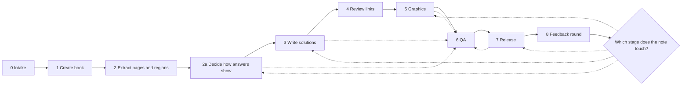

# Workflow: from two PDFs to a live book

This is the standard pipeline for adding a book (one chapter of notes) to the
ebook library — the `books/` folder of this repository, one folder per book,
listed in `books/catalog.json` and served by `reader.html?book=<id>`. It is the
JM26 (B) build, reordered and simplified: everything that took a feedback round
on JM26 (B) is now a default from the start (see "Defaults learned from JM26 (B)"
at the end).

Words used below, once:

- **book / chapter**: the same thing. A book is one `<id>` under `books/`; the
  docs say "chapter" because the notes are one chapter of a larger series.
- **reader**: `reader.html`, the one page that shows any book, with the answer
  overlay, the toolbar and the saved ink.
- **saved ink** (`<id>` ink store): what the reader keeps on each iPad for one
  book — pencil strokes, highlights and the reveal state — under the book's
  `storage` key. Renaming the id loses it, which is why an id is never renamed.
- **printed panel**: a figure or box printed on the page that gets an animation
  or a graphic laid over exactly that region.



A feedback note is routed to the stage it belongs to — an answer-display note to
2a, a wording or method note to 3, a figure note to 5, a cache or file note to 7
— and **every round ends with Stage 6 QA again** (the dotted edges). A round is
not done when the edit is made; it is done when QA passes.

| Stage | Output | Tool | Typical effort |
| --- | --- | --- | --- |
| 0 Intake | chapter brief + acceptance checklist | — | 10 min |
| 1 Create | `books/<id>/` with the PDFs | `new_book.py` | 1 min |
| 2 Extract | `book.json` question list, `pages/`, `layout.json`, teacher crops | `extract_pages.py`, `extract_ans_refs.py` | 30 min |
| 2a Decide how answers show | the mode recorded in the chapter log | `layout_triage.py` | 10 min |
| 3 Solutions | `solutions.js` written, then checked by a second Bot | by hand from the ANS crops; `verifier` Bot | 2–6 h for 30–60 questions |
| 4 Links | `links` in `solutions.js` | `check_book.mjs` | 30–60 min |
| 5 Graphics | `widgets.js`, `media`, `guides`, `endPages` | `engine/widgets/kit.js`, `render_media.py` | 2–8 h, depends on the figures |
| 6 QA | report and screenshots | `check_book.mjs --shots` | 30 min |
| 7 Release | live link, tag | git, GitHub Pages | 10 min |
| 8 Feedback round | routed fixes + QA rerun | — | per note |

---

## Stage 0: Intake

What is needed from the teacher for each book:

- [ ] The **QUE PDF**: the question notes with blank answer spaces. Its pages become the ebook's background.
- [ ] The **ANS PDF**: the same notes with the teacher's working in red-bordered boxes. This defines the method every solution must follow.
- [ ] The **form, code and title** as printed, e.g. S3 · JM26 (B) · Inequalities I.
- [ ] Any **special requests**, for example a particular graphic ("Q2: fix the side at 3, slider for the number of sides").

**Intake acceptance** — check before Stage 1, because a bad input is cheaper to
reject than to fix:

- [ ] The PDF is a real vector file with a text layer, and the red working is
      pure-red vector boxes (a scan has no red boxes to cut and no text layer;
      if it is a scan, say so in the chapter log and expect `fixedAnchors` and
      hand-made regions).
- [ ] The page size is A4 portrait (595 × 842 pt) unless the notes really are a
      different size — Stage 2 reads the size from the PDF, but every override
      in `book.json` is in that page's own points.
- [ ] Both PDFs have the same page count, or the ANS offset is known.
- [ ] The ANS really is the answer to this QUE (same questions, same numbering).

**No ANS at all?** Stop and ask: without the key there is nothing to check the
solutions against. **The teacher sends a newer PDF later?** Keep the book id
(the ink store depends on it), replace `source/`, re-run Stage 2, and re-do 2a,
because new pages can change the answer geometry; note the version and date in
the chapter log.

Decide and note in the chapter log (`docs/chapters/<id>.md`):

- the **book id**: short, lower case, never renamed later, e.g. `jm26b`. It names
  the saved-ink store on every iPad (see "saved ink" above);
- the **sections** for the top bar, from the section titles in the notes (e.g. Practical, MC, Challenge);
- which questions are **printed worked examples**. Their answer is already on the page, so they get only a graphic button.

## Stage 1: Create the book

```powershell
python tools/new_book.py <id> --form S3 --code "JM27 (A)" --title "Inequalities II" --topic Inequalities --que "<path>\...(QUE).pdf" --ans "<path>\...(ANS).pdf"
```

This copies `books/_template/`, puts both PDFs in `books/<id>/source/`, fills in `book.json`, and adds the book to `books/catalog.json` with status `draft`. Also copy `docs/chapters/_template.md` to `docs/chapters/<id>.md`.

`book.json` is the single source of truth for a book's state (`status`),
sections and extraction settings. `books/catalog.json` only lists the books for
the library page, and the `README.md` table is a human index: both are generated
or checked against `book.json`, never edited the other way round. The shape of
every field is in [02-book-format.md](02-book-format.md); a minimal one:

```json
{
  "id": "jm27a",
  "form": "S3",
  "code": "JM27 (A)",
  "title": "Inequalities II",
  "status": "draft",
  "storage": "jm27a",
  "source": { "que": "source/…(QUE).pdf", "ans": "source/…(ANS).pdf", "ansPageOffset": -1 },
  "sections": [{ "id": "practical", "label": "Practical" }],
  "extract": {
    "questions": [{ "id": "q1", "page": 3, "label": "1", "section": "practical" }],
    "anchors": { "ex1": "Example\\s*1" },
    "fixedAnchors": { "ex2lq": [420.5, 432.0] },
    "overrides": { "q7": { "space": 40 } }
  }
}
```

**Only the ANS was supplied?** Make the question paper from it first, and pass that as `--que`:

```powershell
python tools/make_que.py "<path>\...(ANS).pdf" "<path>\...(QUE made).pdf" [--red-text list|cover|black]
```

It removes the teacher's pure-red answer boxes, the "Answer" stamp, and the `*`
that marks an MC answer. "Inside a box" means the object's bounding box is at
least 90 % within the red frame; a figure that merely touches a box is kept
whole. A teacher image laid over a figure is deleted as an object, so the figure
underneath shows again. A thin white line over each removed frame hides faint
leftover edges, except where the frame crossed a figure, so it never cuts
through one. Red text outside the boxes is listed by default; use `cover` for
stray working or `black` when the correct MC option is printed in red.

Then verify it, and keep the check as a regression: `make_que` on the ANS of a
chapter whose real QUE exists must reproduce that QUE — JM29 (B) is 0 pixels
different. Keep 3–5 such chapters as samples, re-run them whenever `make_que`
changes, and treat more than 50 changed pixels on a page as a failure. The tool
also reports how many objects it removed per page; compare that list with the
page by eye.

## Stage 2: Extract pages and answer regions

1. **Draft the question list:**
   ```powershell
   python tools/extract_pages.py <id> --scan
   ```
   This prints the section titles it finds, and a JSON draft of every numbered question and Example/Practice heading with its page. Copy it into `book.json` → `extract.questions`, then:
   - give each item a `section` id from `book.json` → `sections`;
   - use the standard ids: `ex1`, `ex2` for examples, `p1a`, `p1b`, `p2` for practices, `q1` … `qN` for numbered questions. `label` is what the jump list shows: "Example 1", "Practice 1a", or just "12" for numbered questions;
   - move each heading's `anchor` regex into `extract.anchors` (`{"ex1": "Example\\s*1"}`). Numbered questions need no anchor: the tool finds "12." at the left margin;
   - delete false hits, such as a section title or a number inside a table.
2. **Render the pages and find regions:**
   ```powershell
   python tools/extract_pages.py <id>
   ```
   This writes `pages/p01.jpg` … (3× zoom, JPEG quality 86) and `layout.json`. Each question's answer region runs from the bottom of its printed text to the next question, or to the footer. The page size comes from the PDF and is written into `layout.json`; nothing assumes A4.
   - `MISSING ANCHOR qX page N` means the label was not found. Fix `anchors`, or pin it with `fixedAnchors` (`"ex2lq": [y0, y1]` in that page's points).
   - **Anchor integrity**: after extraction, every question in `book.json` must appear exactly once in `layout.json`, in reading order, with `region` inside the page. `check_book.mjs` fails a missing or inverted region; re-run extraction rather than editing `layout.json` by hand. A `fixedAnchors` pin is silently wrong after the PDF is re-rendered, so re-check those questions when `source/` changes.
3. **Override regions the gap rule cannot infer** (`extract.overrides`, in PDF points `[x0, y0, x1, y1]` with the origin at the top left — read the real page size from `layout.json`, e.g. 595 × 842 for A4):
   - framed or boxed examples and practices: `region`;
   - MC questions, where the working space sits beside the options: `region`, plus `square` for the printed answer box;
   - an option to circle: `ring`;
   - a region drawn over printed ruled lines: add `plain: true`, so the ruler lines are not mistaken for a figure beside the answer.

   Find coordinates by opening the page image (1 pt = 3 px at zoom 3, or whatever `extract.zoom` says), or from the words in `layout.json` → `pages[n].text`. Re-run step 2 after every change.
4. **Crop the teacher's working:**
   ```powershell
   python tools/extract_ans_refs.py <id>
   ```
   This writes `reference/ans/pNN_KK.png`, one per red box on ANS page NN, and full-page previews in `reference/ans_pages/`. Check `source.ansPageOffset`: ANS PDFs usually have no cover, so ANS page = QUE page − 1.

## Stage 2a: Decide how the answers show (before writing any solution)

The notes decide this, not the writer's taste. Run the triage on the first layout:

```powershell
python -X utf8 tools/layout_triage.py <id>
```

It reads `layout.json` and the page images and reports, per page, the gap under each question and the largest blank band, then gives a verdict:

| The notes look like | Verdict | What to set |
| --- | --- | --- |
| A workbook: a blank band under every question, a blank row to cut at | **inline** — the answer is typeset in the page, inside the region | `space` in `extract.overrides` for the questions that need room |
| A worksheet: questions 10 pt apart, figures or printed tables crossing the rows, fill-in blanks on every line | **stamps** — the ANS's own red answer is cut out and pasted back into its blank, hidden until tapped | `"answerStamps": ["q1", …]` in `book.json`, then `python -X utf8 tools/answer_stamps.py <id>` |
| The same worksheet, but the ANS has no red marks to copy | **cards** — the working opens over the page from a `?` chip at the blank line | `"answerCards": ["q1", …]` in `book.json` |
| Every page a worksheet with no answer space at all | cards for the whole book | `"answers": "cards"` |

Shape of the two lists: a plain array of question ids, `["q1", "q2", "hw3"]`.
A question not in the list keeps the inline answer, so MC and long questions
are simply left out. A stamp question may also carry `"stampOverride": { "hw4":
[127, 249, 226, 272] }` — the box in page points — when the automatic cut picks
the wrong red marks; a list of boxes pins more than one stamp.

- **Inline** cuts the page at `region[3]` and moves the rest of the page down; the cut must fall in a blank row (see [02-book-format.md](02-book-format.md) → Answer space and page cuts).
- **Cards** never cut or move the printed page: a `?` chip at the top-right of the fill-in line opens the working over the page. MC and long questions stay inline, so a book can mix the two.
- **Stamps** never cut or move the page either: the reader draws the key's own image over the blank, hidden until that blank is tapped, and Show all / Hide all drive the lot.
- Do not "fix" a bad region by hand in `layout.json`. An inverted region (bottom above top) makes the reader cut the page *above* the answer, so the card lands on the next question's printed text — exactly the fault that made `p5m07a` look broken. `extract_pages.py` no longer writes one, and `check_book.mjs` fails if one appears.
- Record the decision (and the list) in `docs/chapters/<id>.md` under **How the answers show**, so the next person does not re-litigate it.

## Stage 3: Write the solutions

Write `books/<id>/solutions.js`, one entry per question in `book.json`, in page order. Work from each question's ANS crop and follow [03-authoring-style.md](03-authoring-style.md):

- [ ] **The same method as the teacher**: same variable, same steps, same final sentence.
- [ ] **One revealable step per line**, with a short side reason where a step needs one ("÷ (−2): reverse the sign").
- [ ] Part labels `h("(a)")`, and **one answer box per part** where the key has side-by-side boxes.
- [ ] Every **final answer checked** against the ANS, including MC letters.
- [ ] Printed examples get `printed: true` and `ctlAt: [x, y]` for their graphic button.

**Independent check.** The author must not be the only checker: after a block of
solutions is written, hand the book to the `verifier` Bot (or any Bot that did
not write them) with the ANS crops, and let it re-derive every numeric and MC
answer. A correct-looking method with a wrong number passes the author's own
reading. If the ANS itself looks wrong (a teacher's slip), do not silently
"fix" it: record it in the chapter log and ask the teacher.

Preview as you go (`python -m http.server 8090 --bind 127.0.0.1`, then `http://127.0.0.1:8090/reader.html?book=<id>`; add `--bind 0.0.0.0` only when an iPad on the same Wi-Fi must reach it). Tap through each question. Answers keep one type size; a long answer scrolls inside its region (order in [05-engine-notes.md](05-engine-notes.md)). Prefer `flow: "col"` (stack the boxes in columns), an explicit box `w` (width in points), or `space` in `extract.overrides` when a short answer should show without scrolling — all three are defined in [02-book-format.md](02-book-format.md). If the regions came from a teacher's answer boxes (`extract.overrides`), first run `python tools/grow_regions.py <id> --write` to widen them into the blank space around them (check the previews in `reference/regions/`), then re-run `extract_pages.py`.

## Stage 4: Review links

For every word problem — a question whose wording, not just its numbers, decides
the method — add `links` that tie key wording in the question to the matching
part of the answer (see the links section of [03-authoring-style.md](03-authoring-style.md)):

- `q` phrases must match the printed words exactly. The match ignores case and punctuation;
- mark the answer side with `L(key, tex)` inside maths, `lk(key, step)` for a whole line, or `[[key|words]]` inside text;
- run `node tools/qa/check_book.mjs <id>`: it lists every phrase that is not found on the page, and every link with no marked answer part.

## Stage 5: Graphics

Add a graphic wherever a picture makes the reasoning visible. Each graphic lives in `books/<id>/widgets.js` and is listed in its `REGISTRY` — a map from question id to the mounting function that `widgets.js` exports (`export const REGISTRY = { q3: mountQ3 }`), read by `engine/book.js`. Start from the pattern in `books/_template/widgets.js`, and reuse ideas from `books/jm26b/widgets.js`:

- a question card at the top, with the same "Let …" lines and inequality as the worked solution;
- a picture of the situation, a slider (− / + / ▶) for the unknown, and a live readout (✓ satisfies / ✗ fails);
- quick buttons for the key values ("Least n: 8");
- maths the students have learned; for example, no function graphs for S3 (see the style guide).

Printed concept panels can become animations instead (`media` in [02-book-format.md](02-book-format.md)): a Manim scene in `tools/manim/` that draws in page points over that printed panel's region (the `region` of the `media` entry) and ends on the complete panel. Check the layout with `python tools/render_media.py <id> --still` against the page, then render the videos. Keep each one under 300 KB — check the size with `Get-Item` after rendering, and re-render a shorter scene if it goes over.

On a PC where Windows Smart App Control blocks Pango's DLL (`cmanimpango.pyd`: "An Application Control policy has blocked this file"), `render_media.py` and `audit_guides.py` fall back to `tools/manim/textsvg.py`. It writes Manim's text SVGs from the system fonts with fontTools, at the same size and baseline as Pango (checked against Pango's cached SVGs to within 0.02 %). It handles kerning but not ligatures or Pango markup; `MarkupText` raises an error. Where Pango loads, it is used as before. `MarkupText` only fails when the scene renders, so list the scenes that use it first (`audit_guides.py` reports them) rather than discovering it mid-render.

A book can end with extra pages (`endPages` in [02-book-format.md](02-book-format.md)):
a summary picture, made as an HTML page under `tools/sheets/` and rendered with
`node tools/qa/render_sheet.mjs`, and a flashcard deck (`books/<id>/flashcards.js`).

Figure questions (the green diamond in the teacher's PDF) can get a solution guide (`guides` in [02-book-format.md](02-book-format.md)). It is a `GuideScene` that redraws the printed figure in page points and follows the teacher's steps in order, with no text lines, because a narrator will speak over it. Show equal parts with the same colour, and show each reason as a real motion: a fold for a mirror line, a half-turn for alternate angles, a slide for corresponding or interior angles, and the three angles of a triangle gathering on a straight line. Never morph one angle into a differently placed one. An answer replaces its unknown in bold red with no box. A question with parts pans from figure (a) to figure (b). Every number and letter keeps a clear margin from wedges, arcs and lines (2 pt from a wedge, 1.2 pt from a line): a wedge is no bigger than the printed arc, a label in a narrow angle moves out along the bisector, and a mirror line breaks around a label it would cross. Words never grow. An unknown flashes red in place (`ask`, `pulse`), a red "?" blinks, and an answer simply turns into bold red, because a word scaled up runs into the lines around it. Run `python -X utf8 tools/audit_guides.py <id> [Class...]` before rendering. It checks the frame after every step and at the largest moment of every Indicate, and lists each label that touches a mark, another label or the frame edge, with the time and the gap in points. Fix scenes until they are clean. Render one scene at a time, because parallel renders collide in Manim's text cache. A re-rendered video keeps its file name, and the reader's service worker serves videos from its cache, so bump `CACHE` in `sw.js` or readers keep the old video.

## Stage 6: QA

```powershell
cd tools/qa; npm install          # first time only
node check_book.mjs <id> --shots
```

Fix every `FAIL`. For every `WARN`, either fix it or record in the chapter log
why it is accepted (`docs/chapters/<id>.md` → Known warnings): a WARN that is
neither fixed nor written down is treated as unfinished. Then go through every
screenshot in `books/<id>/reference/qa/`, and run the iPad checklist in
[04-qa-and-release.md](04-qa-and-release.md).

A book is ready to release when `check_book` reports **0 FAIL and 0 WARN**, or
when every remaining WARN has a written acceptance in the chapter log. Run
`node tools/qa/check_catalog.mjs` too: it fails a live book missing from the
catalogue, a listed book with no folder, and a live book with no chapter log.

Two more checks guard the answer controls, because they are drawn over the
printed page and are the part a teacher notices first:

```powershell
python -X utf8 tools/qa/check_answer_chips.py <id>   # chips and Play buttons on blank paper
node tools/qa/check_play.mjs <id>                    # Play buttons in a real browser
python -X utf8 tools/qa/check_cuts.py <id>           # page cut lines on blank paper
```

`check_answer_chips` reads `layout.json` and the page JPEGs: no `cardAt` chip and
no `answerStamps` Play button may cover printed ink, the amber widget button of a
stamped answer must clear both the ink and its Play, and two buttons may not
share a box. `check_play` opens the reader and proves each stamped answer has one
Play, that it is the same box, fill, corner and `▸` as the LQ answer's Play, that
the amber widget button is drawn at its measured `graphicAt` and opens the drawer,
that none sits under the docked toolbar, and that a tap opens and closes the
answer. `check_cuts` proves the line where the page is opened for a question
(`region[3]`, cut across the whole page width) carries no printed ink: a cut
through a printed answer box or a figure's arc shows as a broken shape, and no
button check would see it.
A Play that only looks right on screen is not verified: match it by measurement.

## Stage 7: Release

1. Set `"status": "live"` in `book.json` (the only place the state lives).
2. Bump `CACHE` in `sw.js` — the site root file, `const CACHE = "ebooks-v17"` →
   `"ebooks-v18"` — so iPads fetch the new files. Bump it for **any** changed
   file, not only a video: a missed bump leaves every reader on the old copy
   until the next release.
3. Commit and push (details in [04-qa-and-release.md](04-qa-and-release.md)).
   Before pushing, tag the previous state (`git tag pre-<id>-vN`) so a bad
   release can be reverted in one command (`git revert` or `git reset --hard
   pre-<id>-vN` and push).
4. **Verify the live site, do not assume it**: after a minute, run
   `node tools/qa/check_live.mjs <id> --expect-cache <the CACHE you bumped to>`.
   It checks the published `sw.js`, the live `book.json` status and the reader,
   layout and solutions files. A push that changed nothing is indistinguishable
   from a push that broke the page until you look.
5. Check `books/catalog.json` still lists the book, and the `README.md` table is
   regenerated from it. The chapter log is updated.

## Stage 8: Feedback round

The teacher tries the book on the iPad and sends notes. For each round:

- **Route the note first**: answer display or layout → 2a; wording, method or
  number → 3; a figure → 5; cache, a file or the live page → 7. A note routed
  to the wrong stage is how a fix silently breaks another page.
- **Re-run QA after the fix** (Stage 6). The round is not finished until QA is
  clean again.
- Before a change that alters the look, tag the current state (`git tag
  <id>-before-<what>`) instead of copying the folder: git already has the
  content, a tag says exactly what to revert to, and it costs no disk.
- Record each decision in `docs/chapters/<id>.md`.
- If a note is about something every book should have, change the engine or this
  guide, not just the one book — and then run the global regression below.

### Global change regression

When `engine/`, `sw.js`, the styles or a QA script changes, every live book may
be affected. Before releasing: list the live books in `books/catalog.json`, run
`node tools/qa/check_book.mjs <id>` for each, and record in the release note
which books were re-checked and which were not touched. A global change with no
regression list is not a release.

---

## Defaults learned from JM26 (B)

Each item below was a separate feedback round on JM26 (B). New books get them
from the start. The **Owner** column says whether the author does something or
the engine already does it for every book:

| JM26 (B) feedback | Default now | Owner |
| --- | --- | --- |
| "Answers should be inside the answer boxes, with margins" | Answers sit in red-bordered boxes inside the blank region, laid out like the ANS key. | author (layout) |
| "I should be able to click step-by-step answers out" | All steps start hidden; tap for the next step, with ▸ » ◂ ↺ controls and a progress count. | engine |
| "I should be able to switch out of writing mode and scroll" | Read tool at the top of the toolbar; one finger always scrolls. | engine |
| "Graphics are not as developed / not aligned with the questions" | Every graphic opens with a question card and uses the solution's own letters. | author (widgets) |
| "Number lines drawn the HKDSE way" | Stem from the value, hollow or filled circle, then the arrow (style guide). | author (solutions) |
| "x and y domain questions: mark both domains, colour the overlap" | Two-variable range questions use an x–y picture with both number lines and the overlap shaded. | author (graphics) |
| "Hold after drawing a line to make it perfect" | Hold-to-snap for lines, circles, rectangles and triangles. | engine |
| "Let me highlight part of an answer line" | The highlighter snaps to individual characters in maths. | engine |
| "Review highlights linking the question to the answer" | Dashed, tappable review links on every word problem. | author (links) |
| "Link only what matters" (Q5) | Link a phrase only when it maps to a specific part of the answer. | author (links) |
| "Use a picture, not a graph of functions" (Q11) | Graphics use pictures, bars and number lines; function graphs only when the students have learned them. | author (graphics) |
| "Remove the MC answers in the MC box" | MC answer squares stay empty unless the teacher asks for the letter (`letter`). | author (solutions) |
| iPad and Pencil delay, palm, edit ink, undo | Built into the engine for every book. | engine |
