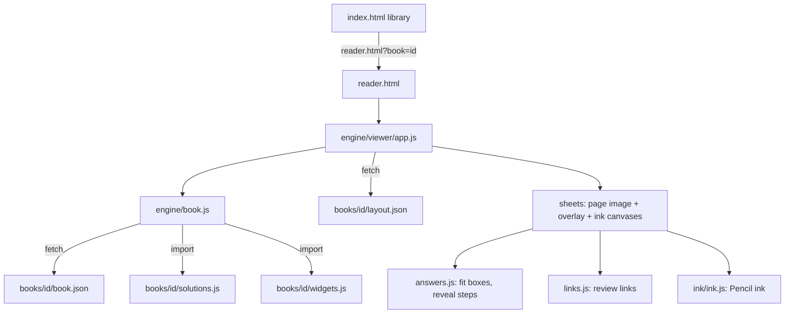

<!-- canon: ebook-starter-v2/docs/05-engine-notes.md · 由 CTO 於 2026-11-27 三路合併 · 改這份，唔好改副本 -->

# Engine notes

The engine (`engine/`) is shared by every book. A change here changes all books, so after any engine edit, run `node tools/qa/check_book.mjs <id>` for **every** book in `books/catalog.json`.

## How a book loads



- `book.js` reads `?book=`, loads the book, and exports `BOOK`, `BOOK_DIR`, `STORAGE`, `SOLUTION_BY_ID`, `hasGraphic`, `mountGraphic` and `pageImage`. With no book, or an unknown id, it sends the reader back to the library.
- `app.js` builds one `.sheet` per page: a background ``, an `.overlay` for answers and links, and canvases for highlighter and pen ink. It handles pan and zoom, which use a CSS transform rather than native scrolling, plus toolbars, thumbnails, the jump list, presentation mode and keyboard shortcuts.
- In presentation mode, `showPage()` records the fitted scale in `present.base`. When a pinch has zoomed past it (`presentZoomed()`), one-finger drags pan with momentum instead of turning or springing back the page, and a resize that leaves the width unchanged (Safari bars sliding) keeps the zoom. A one-finger double tap, or pinching back below the fit, returns to `showPage()`.
- `answers.js` sets every answer at the book's type size (`BOOK.answerScale`, default 1). At reader size 100% it tries, in order: the authored layout, long equations broken before "=", tall boxes cut into side-by-side columns (`split()`), then a flowing wrap that may scroll inside the region (visible `.qa-bar`). In a wrapped box (`fitInWidth`) a step that is too long breaks before "=", and its reason moves to the end of the last row (`.ln.tuck`); a reason drops under its step (`.ln.drop`) only when even that row has no room. When the region's width forces such a break, the answer (or its last part column) may also use the button strip if that avoids the break, and the buttons move into the page margin (`answerRight`). The strip of buttons is always placed after the working's right edge; when the region's edge or a figure beside it leaves no paper there, the strip goes past the ink into the margin instead of covering a step of maths. It is placed again after every reveal (`paint`) and once more after the layout settles (`layoutAnswers`), so a strip measured against a half-built answer never stays on the working. That strip, and the buttons, stop 14 pt short of a figure beside the region. Each step line is only as wide as its text, so the grey placeholder bar cannot run past the working onto a figure. Parts printed side by side as `(a)` `(b)` on one row get each answer box under its own label (`partColumns`). Authored `space` on a question opens the page under that region; a reader size other than 100% grows the region and opens the page the same way (`growSheet`). Reveal, wheel and drag scroll a long answer before moving the page. For a book with `book.json` `"answers": "cards"` the answer lives in a hidden card instead: a control button 22 px tall (`engine/styles.css:408` `.ctl button`) with a 15×15 `?` icon (`engine/styles.css:423` `.ctl button svg`) on the printed line opens it over the page (no region, no page cut, `space` ignored), `openAnswer()` fits the working to the card with `flowFit` and sizes the card to it, and `closeAnswer()` hides it on ✕, Escape or a tap outside; the chip and the card are exempt from the post-drag click suppression in `app.js`.
- `media.js` lays each `book.json` `media` entry over its page region: a `<video>` showing its poster (the last frame) plus a round button on the panel's corner. The button carries `data-media`, so the world click handler toggles play, pause and replay in every tool, as it does for `data-act` answer buttons.
- `guide.js` makes the film button (`guideButton`, `data-act="guide"`) that `answers.js` puts in the control strip of a question listed in `book.json` `guides`, and `openGuide` shows its video in a modal sized to the video's aspect ratio. The modal has its own bar (play/pause, a seek slider and the time), not the native controls, so nothing covers the figure. Escape closes it; Space or K toggles play, and the arrow keys seek by 5 s.
- `endpages.js` reads `book.json` `endPages`. `app.js` adds one sheet per entry after the printed pages, with `data-label` (shown in the page label and thumbnail) and `data-thumb` (the thumbnail image; a sheet without one gets a coloured tile). A deck sheet has class `deck` and `data-no-ink`, which `ink.js` honours for every tool except the laser. `engine/deck/deck.js` draws the cards and keeps progress in localStorage (`<storage>-deck-<key>`); its `checkDeck()` is what `check_book.mjs` uses to validate a deck, before tapping through every card with a finger.
- `links.js` finds `q` phrases in `layout.json` text, measures the marked answer parts, and draws the markers, tags and leaders. Question-side markers are dashed (then solid) boxes; answer-side markers are coloured dotted underlines (solid when open), with a transparent hit area so a tap still toggles the link. Nested `.lk-*` pieces drop each underline by 2.6 pt so they stay readable. On a scrolling answer only the lines in the window are marked.

## Coordinates

Everything on a sheet uses PDF points (595.32 × 841.92 for A4), the same units as `layout.json`, so overlays line up with the page image at any zoom. Strokes are also saved in points, so ink stays aligned after rotation or a zoom change.

## Storage on the device

| Key | Where | Contents |
| --- | --- | --- |
| `<storage>-ebook` | IndexedDB, store `kv`, key `strokes` | all ink for the book |
| `<storage>-ui` | localStorage | revealed steps per question, tool, toolbar dock, link hints on or off |
| `<storage>-deck-<key>` | localStorage | flashcard order, answers and current card for an end-page deck |
| `library-last` | localStorage | the last opened book, for the library's Continue button |

`storage` comes from `book.json`. JM26 (B) uses `jm26b`, which keeps the names from before the databank (`jm26b-ebook`, `jm26b-ui`), so existing ink survived the change.

Safari may delete a website's data if it isn't opened for about a week. Adding the site to the Home Screen protects it. "Save ink file" exports a backup.

## Offline (service worker)

`sw.js` serves code network-first, so a reload picks up changes while online. Images, vendor files and page JPEGs (`/assets/`, `/vendor/`, `/pages/`) are served cache-first. Videos (`/media/*.mp4`) are cached whole and answered from the cache with a 206 slice for each `Range` request, because Safari only plays video that way. **Bump `CACHE` on every release.**

## Ink and Apple Pencil: lessons learned

These cost real debugging time on JM26 (B). Keep them in mind when touching `engine/ink/` or the pointer code in `app.js`:

- **Input model.**
  - Pencil (`pointerType: "pen"`) draws, a finger scrolls and zooms, and a mouse draws.
  - Touches are ignored while the Pencil is down and for 500 ms after (palm rejection).
  - Only the pointer that started a stroke (`activeId`) can move or end it; otherwise a lifting palm ends the Pencil stroke.
- **Safari holds back quick strokes** while it checks for a double tap or a scroll. `claimStylus` calls `preventDefault()` on stylus touch events in drawing tools. `gesturestart` is also prevented, to stop whole-app zoom.
- **`getCoalescedEvents()` is empty on `pointerdown`.** Fall back to the event itself, or the first point is lost and a quick tap leaves no dot.
- **Canvas memory.**
  - iPad Safari limits each canvas to about 16.7 MP, and limits all canvases together by memory.
  - Only pages near the screen that have ink get full-size canvases (`MAX_PIXELS` = 5e6). Pages far away are released to 1 × 1 and repainted on return.
  - Zoomed past that, a canvas covers only the screen plus a margin (`VIEW_MARGIN`, `VIEW_PIXELS`), positioned in page units, so ink stays at screen sharpness. Panning keeps the current view while it still covers the screen, then repaints. The live layer clears only the box it last painted.
  - The stroke in progress is drawn on its own `live` layer; lifting the Pencil adds just that stroke to the page.
- **Saving.** Saves are debounced by 1.5 s and never run mid-stroke. Ink is flushed immediately on `visibilitychange` (hidden) and `pagehide`.
- **Smoothing and pressure.**
  - perfect-freehand with `smoothing` 0.5, `streamline` 0.3 and `last: true`;
  - a pressure curve that lifts light touches;
  - taper scaled to stroke length (at most 8 pt, 30 % of the length), so short strokes keep their body;
  - a pen mark whose bounding box has a diagonal under size + 3.5 pt is drawn as round dabs (`dab()` in `render.js`), not by perfect-freehand. perfect-freehand drops the points of such a short stroke and tapers both ends to nothing, so a Pencil tap, which always wobbles a little, drew a mark 0.02 pt wide: dots were nearly impossible and short dashes vanished. `check_book.mjs` taps a jittery pen and fails if no dot shows;
  - predicted events where Safari provides them.
- **Snapping.**
  - Holding still for 520 ms recognises a line, rectangle, ellipse or triangle (`shapes.js`).
  - The highlighter snaps to the text rows of `layout.json`, and to per-character boxes in the revealed answers, so part of a line can be highlighted.
- **Stroke model.**
  - Each stroke is `{ id, page, tool, color, size, points: [{x, y, p, t}], shape?, cut? }`. `page` is the sheet key (`p3`).
  - Undo history entries are `add`, `swap` (removed/added) and `clear`, capped at 120.
- **Finger gestures.** A two-finger tap undoes and a three-finger tap redoes. Either is cancelled by more than 14 px of movement, or by holding longer than 450 ms.

## Maths rendering

- KaTeX renders with `trust` for `\htmlClass` only; that's how `L()` marks link parts.
- `plain()` in `answers.js` turns each step into readable text for the PDF export.
- Layout runs twice: once at load and again after `document.fonts.ready`, because KaTeX fonts change line widths.

## Testing tips (headless Chrome)

- Emulate the iPad with viewport 1180 × 820, `deviceScaleFactor: 2`, `isMobile` and `hasTouch`.
- Send Pencil input with CDP `Input.dispatchMouseEvent` plus `pointerType: "pen"`, and touches with `Input.dispatchTouchEvent`.
- Keep test points inside the visible viewport; points below it hit `<html>`, not the sheet.
- The reader pans with a transform, so `scrollIntoView` does nothing. Navigate with `location.hash = "<sheet key or question id>"`; a question id wins when it equals a sheet key (`p2`). Fine-tune the position with `page.mouse.wheel`.
- To read saved ink immediately, fake `document.visibilityState = "hidden"` and dispatch `visibilitychange`, then read IndexedDB.
- A static server for tests must send `.mjs` as `text/javascript`, or the freehand module fails to load.

## Page numbers

Every printed page must show its own page number, and a clean text layer does not prove it does. The
number can sit under a figure, a dimension line or a white box that the page render put on top of it:
the string is still in the PDF, the pixel is gone. `docs/chapters/*` records the books where this has happened.

Measure it, never assume it:

```powershell
python tools/qa/check_folio.py <id>          # add --verbose to list every page
```

The tool takes the folio's box from `layout.json` `pages[n].text` (the right-most all-digit word near
the footer), measures ink inside that box on `pages/pNN.jpg`, and also measures a 2 px ring just
outside it. `MISS` = the box is empty (the number is not drawn); `LOOK` = something else crosses the
box, so a reader cannot be sure the number is visible. Exit 0 only when every page is clean.

When a folio is missing or covered, **do not move the printed art** - put the number where the page is
blank:

1. Find a measured blank strip. Below the footer is usual: the footer row of these books sits at
   y 798.9-815.5, so y 821-840 is blank unless a figure runs to the paper edge.
2. Lift the glyph from a page that already prints that digit, at the same size - e.g. the `5` of
   `15` on jpfm08 p15 is 5.0 × 16.6 pt - and paste it at x 536-541 (right margin, same as the other
   pages) with `PIL`, saving the JPEG at quality 95, subsampling 0.
3. Record the hand-placed box in `books/<id>/folio.json`, keyed by page number:

   ```json
   {"5": [536.4, 821.0, 541.4, 837.6]}
   ```

   `check_folio.py` trusts that box instead of the text layer for that page, so the page stops being
   reported forever.
4. Re-run `check_folio.py <id>` and look at the crop.

Hand-placed so far:
- **spem02** p2 and p16 (the printed figure sits over the usual spot): x 529-541, y 797-809.
- **spem02** p5, p9, p10, p11: the source PDF clips p5's own "5", and p9/p10/p11 carry no number at
  all, so an earlier pass pasted them at the printed height (y 783-791) where they landed on printed
  matter - a rule under p9, the caption "(b)" under p10, the "3 V" label under p11. All four now sit
  in the measured blank strip below the footer, right-aligned to x 541.4, y 820-828.
- **jpfm08** p5 (under the footer, x 536-541, y 821-838).

When you move a hand-placed folio, white-fill its old box (keep clear of every printed mark - check the
ink map row by row first) and take the glyphs from pages that print them intact: on spem02 the `1` comes
from p12 "12", the `5` from p15 "15", the `9` from p19 "19" and the `0` from p20 "20". A single digit is
right-aligned so it ends at x 541.4, the same right edge as the printed ones. `check_folio.py` is part of the §6 QA gate in
`.cursor/skills/build-ebook/SKILL.md`: run it on every book after any engine change, and on a book
whenever its page images or `layout.json` are rebuilt.

## Before you change a shared engine function

`engine/viewer/answers.js` is one long module with shared helpers (`regionHeight()`,
`answerSize()`, `fit()`, `layoutParts()`, `flowFit()`, `growSheet()`). A change there
reaches every book on every device, and the call sites are not obvious by eye.

Graphify is installed locally (`graphify` 0.9.103) and answers exactly that question:

```powershell
# once per machine, ~1 min, local AST only, no API key, writes nothing into the repo
$env:GRAPHIFY_BACKEND="none"
graphify extract . --code-only --out <some temp dir>

# then, before touching a shared helper:
graphify affected "engine_viewer_answers_regionheight" --graph <temp>/graphify-out/graph.json --depth 2
```

It prints every caller with file and line, which is faster and safer than guessing.
Two limits found in the pilot: a free-text `graphify query` is noisier than `grep` in a
repo this size, and it cannot see links that exist only by file-naming convention (for
example `render_media.py` -> `media.js`), so keep using `grep` for "where is X written".

**Do not** run `graphify install`: it writes hooks and `AGENTS.md` into other agents'
configs. Do not let it index teacher PDFs (`--code-only` only); the semantic pass would
send that material to a model.


---

## Maths only (verbatim from the maths repo — NOT yet reconciled with the base above)

- `answers.js` sets every answer at the book's type size (`BOOK.answerScale`, default 1). At reader size 100% it tries, in order: the authored layout, long equations broken before "=", tall boxes cut into side-by-side columns (`split()`), then a flowing wrap that may scroll inside the region (visible `.qa-bar`). In a wrapped box (`fitInWidth`) a step that is too long breaks before "=", and its reason moves to the end of the last row (`.ln.tuck`); a reason drops under its step (`.ln.drop`) only when even that row has no room. When the region's width forces such a break, the answer (or its last part column) may also use the button strip if that avoids the break, and the buttons move into the page margin (`answerRight`). The strip of buttons is always placed after the working's right edge; when the region's edge or a figure beside it leaves no paper there, the strip goes past the ink into the margin instead of covering a step of maths. It is placed again after every reveal (`paint`) and once more after the layout settles (`layoutAnswers`), so a strip measured against a half-built answer never stays on the working. That strip, and the buttons, stop 14 pt short of a figure beside the region. Each step line is only as wide as its text, so the grey placeholder bar cannot run past the working onto a figure. Parts printed side by side as `(a)` `(b)` on one row get each answer box under its own label (`partColumns`). Authored `space` on a question opens the page under that region; a reader size other than 100% grows the region and opens the page the same way (`growSheet`). Reveal, wheel and drag scroll a long answer before moving the page. For a book with `book.json` `"answers": "cards"` the answer lives in a hidden card instead: a 15×15 `?` icon (`engine/styles.css:423` `.ctl button svg`) in the 22 px-tall control button (`engine/styles.css:408` `.ctl button`) in the left margin opens it over the page (no region, no page cut, `space` ignored), `openAnswer()` fits the working to the card with `flowFit` and sizes the card to it, and `closeAnswer()` hides it on ✕, Escape or a tap outside; the chip and the card are exempt from the post-drag click suppression in `app.js`.
